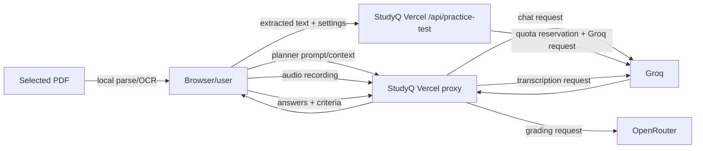

# StudyQ AI processing transparency

StudyQ has no account system or central student database in this repository. AI features are optional and are activated by the user. Do not submit passwords, sensitive personal data, confidential school records, or information about other people unless necessary and appropriate.

| Feature | Provider/model | Data flow and content | Persistence/limits |
|---|---|---|---|
| Test Week Planner | Groq, `openai/gpt-oss-120b` | Browser sends user prompt plus selected saved test/homework/planner context and limited prior conversation through StudyQ Vercel proxy to Groq | Conversation history is localStorage, capped/pruned by planner module; provider/Vercel retention unknown |
| Practice Test | Groq, `openai/gpt-oss-120b` | PDF parsing and scanned-page OCR occur in browser; extracted text and settings are sent to the dedicated StudyQ Vercel `/api/practice-test` function, which sends prompt batches to Groq. PDF page images/files are not sent in this generation flow. | Frontend limits PDF 50 MB/100 pages and material 100,000 chars; generated tests may be saved locally. A separate IP-keyed quota uses a keyed digest and timestamps in Upstash Redis once configured; no prompt or PDF content is stored in the quota records. Provider retention unknown. |
| Voice dictation | Groq `whisper-large-v3` | User activates microphone; browser records audio and sends it through StudyQ proxy to Groq for transcription | Recording limited to 120 seconds in client; exact provider retention/region unknown |
| Open-answer grading | OpenRouter, `liquid/lfm-3-1.7b:free` | Questions, marking criteria, student answers and grading prompt go through StudyQ proxy to OpenRouter | Output returned to browser; provider retention/region/model route details unknown |

StudyQ source does not establish whether providers retain requests, use them for training, process them in a specific region, or act as processor/controller for each operation. Obtain current provider terms, account controls and DPAs before making those claims.

Practice Test generation is limited in source to five successful generated tests per IP in a rolling hour. The code uses Upstash Redis atomic scripts, but production enforcement is **pending** until the project is connected to Redis and its required environment variables are set. See [Practice Test generation rate limit](practice-test-rate-limit.md).
