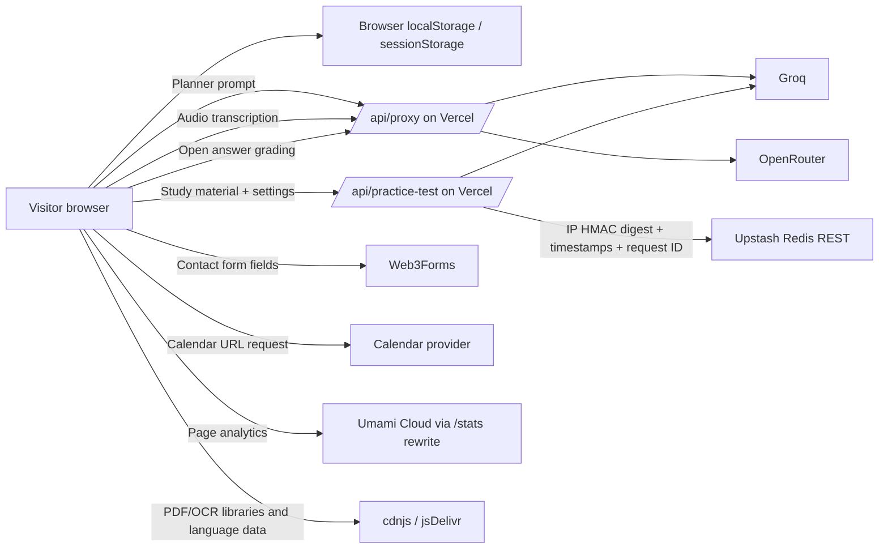

# StudyQ Complete Website Systems, Security, Privacy & Quality Audit

**Review date:** 15 November 2026  
**Scope:** Current repository source, static configuration, local documentation and client/server request flows.  
**Review type:** Source audit and Sprint 1 remediation. Application source was changed in the files listed in the remediation ledger; no dependencies or production data were changed.

## Executive summary

StudyQ is a static multi-page study-tools site with two Vercel serverless endpoints. Study content is mostly held in the visitor's browser; AI and contact features send selected content to external providers. There is no account system or central application database in the reviewed source.

The most important findings are:

1. **High — shared AI quotas are implemented in source but not deployment-verified.** `/api/proxy` now applies separate durable Upstash hourly limits to Planner, voice transcription and grading. Redis configuration and live Vercel behavior remain unverified.
2. **High — Practice Test quota is improved in source but not production-verified.** Failed generations release their reservations; uncertain successful generations keep a reservation counted for a full hour. No live Redis/Vercel/Groq test was possible.
3. **Medium — planner deletion persistence is fixed in source.** The empty list is now saved, preventing a deleted final test from restoring from the old storage value.
4. **Medium — calculator numeric validation is fixed in source.** Complete-string parsing rejects trailing junk, out-of-range grades and invalid/zero/very large weights.
5. **Medium — analytics remains automatic on 10 of 13 substantive pages.** The exact page coverage and settings are documented; no accept/reject popup was added. Umami dashboard and production request behavior are still unverified.
6. **Medium — GDPR accountability and provider-specific details remain open.** Privacy and cookie text now reflect the shared AI quotas and analytics behavior, but lawful bases, provider contracts, regions, retention and transfers need controller review.
7. **Low — the duplicate Practice Test handler was removed.** Only the Vercel `api/practice-test.js` endpoint remains; no second deployment configuration was found in the repository.

No source-only audit can prove deployed headers, secrets, firewall rules, Upstash atomic behavior, browser network requests, or third-party retention. These are marked as pending instead of inferred as passing.

## System inventory

| Area | Main files / implementation | Status from source review |
|---|---|---|
| Public site and navigation | `index.html`, `js/site-navigation*.js`, shared CSS | Static pages; language and sidebar preference in localStorage; no account/backend content store observed |
| Grade calculator | `calculator/index.html` | Client-side weighted grade calculations; no server request observed |
| Vocabulary practice | `vocab/index.html` | Client-side answer matching and session progress; session saved locally |
| Flashcards | `flashcards/index.html`, `flashcards/flashcards.js` | Client-side decks and progress in localStorage; CSV/JSON export |
| Planner | `planner/index.html`, `planner/planner.js` | Tests, homework, history and AI output stored locally; calendar feeds fetched directly by browser; AI calls proxy |
| Pomodoro | `pomodoro/index.html` | Client-side timer and audio; ambient preference stored locally; no server persistence observed |
| Practice Test | `practice-test/index.html`, `js/practice-test.js`, `api/practice-test.js` | Browser PDF/OCR processing; extracted material sent to dedicated Groq endpoint; quota code uses Upstash REST |
| AI proxy | `api/proxy.js` | Vercel Edge endpoint for planner chat, voice transcription and OpenRouter grading |
| Contact | `contact/index.html`, `contact/contact.js` | Browser sends form directly to Web3Forms |
| Privacy tools | `privacy/index.html`, `js/privacy-data-controls.js` | Browser data-clear UI; targets StudyQ-prefixed storage keys |
| Deployment | `vercel.json`, `robots.txt`, `sitemap.xml` | Security headers, CSP Report-Only, analytics rewrite, URL redirects and static SEO metadata |

No package manifest, lockfile, test runner, build script, CI workflow, or framework configuration was found in the reviewed project files. The site relies on plain source files and third-party CDN assets.

## Data-flow map

The browser is the primary store for user-created study material. AI requests transmit the relevant prompt or extracted content to the relevant provider. The Practice Test quota record is separate and is designed not to include study content.

## Findings

### F-01 — Anonymous AI proxy can incur provider usage without app-level quotas

**Severity: High**  
**Evidence:** `api/proxy.js`; proxy request path in `planner/planner.js`, `planner/index.html`, and `js/practice-test.js` for grading.

The proxy limits allowed API paths, models, input sizes, output tokens, upstream duration, and response size. It does not implement a durable per-IP limit or user authentication. Its allowed-origin logic controls browser CORS response access; it is not authentication and does not prevent direct non-browser HTTP clients from calling the endpoint. A caller can submit valid model requests and use the server's Groq/OpenRouter credentials, subject to provider limits and any external Vercel Firewall rule.

The Practice Test route's Redis quota is feature-specific and does not count planner, transcription, or grading requests. The Vercel Firewall configuration was not present in the repository, and the earlier screenshot represented an unsaved rule form rather than deployed evidence. Therefore, the effective deployed limit for `/api/proxy` is **unknown**.

**Impact:** Unexpected AI spend, service exhaustion, or provider quota depletion if storage is unconfigured, unavailable, or limits are set too high.

**Remediation status:** Implemented in source; mock-tested; production verification pending. `api/proxy.js` now uses the existing Upstash credentials and `STUDYQ_RATE_LIMIT_HMAC_SECRET`, with separate hourly namespaces and atomic Lua reservations for Planner (default 20/hour), transcription (10/hour), and grading (30/hour). Limits can be overridden with `STUDYQ_AI_PLANNER_LIMIT_PER_HOUR`, `STUDYQ_VOICE_LIMIT_PER_HOUR`, and `STUDYQ_GRADING_LIMIT_PER_HOUR` (integer 1–1000). Defaults are initial guardrails for typical student use; traffic and provider-cost telemetry is unavailable, so the values should be reviewed after launch. Limits count concurrent requests as reservations; upstream failures release them when Redis is reachable. A successful provider request whose Redis completion cannot be confirmed keeps its reservation for the hour. If Redis is also unavailable during a failed-request release, that pending reservation remains until expiry, which can temporarily reduce allowance. Missing/invalid store settings return 503. IP extraction uses Vercel's documented overwritten `x-forwarded-for` value ([Vercel request headers](https://vercel.com/docs/headers/request-headers)). Both related Redis keys include a shared hash tag for Redis Cluster script compatibility. Mock checks covered exact caps, isolation, concurrent calls, failure release, 429/Retry-After, and fail-closed behavior. The mocks do not execute Lua. Vercel environment configuration, deployed IP headers, actual Redis behavior, Firewall settings, spend alerts and real-provider smoke tests remain open.

### F-02 — Practice Test quota source implementation is not proof of production enforcement

**Severity: High until deployment verification; source design is substantial**  
**Evidence:** `api/practice-test.js`; `docs/practice-test-rate-limit.md`; UI status and submission in `js/practice-test.js`.

The endpoint requires `UPSTASH_REDIS_REST_URL`, `UPSTASH_REDIS_REST_TOKEN`, and a 32-character-minimum `STUDYQ_RATE_LIMIT_HMAC_SECRET`, returning 503 when configuration is absent. It reserves capacity atomically through Redis Lua before the Groq call, supports a rolling one-hour success set, uses a keyed HMAC of the forwarded client IP, and returns 429 with `Retry-After` at the limit. Input validation occurs before reservation. Failed model requests attempt to release the reservation. The client queries usage from the server and keeps idempotency state in memory rather than using browser storage for enforcement.

The local documentation explicitly marks durable configuration and production verification as pending. It reports mock-handler scenarios, but those do not execute the Lua scripts or prove the deployed request adapter, Redis connection, actual Vercel forwarded IP header, or the Groq path. A further edge case is that if Groq completes but the Redis completion write fails, the endpoint returns 503 while leaving only the short-lived pending reservation. The user may not receive the generated test even though the provider succeeded; after the reservation expires the attempt may no longer count as a successful quota entry.

**Impact:** Before configuration, Practice Test generation is intentionally unavailable (503). After configuration but before live testing, race handling, quota accounting and browser display remain unverified in the actual deployment.

**Remediation status:** Source implementation updated; mock-tested; production verification pending. `api/practice-test.js` now retains uncertain reservations for the full quota window rather than expiring them after two minutes. This preserves quota accounting after a provider success followed by a Redis completion failure, at the cost of temporarily reserving one slot after an interrupted request. The client now marks its allowance unavailable on server errors rather than showing a stale count. Mock handler tests in this sprint covered 1–5 accepted, 6th rejected, duplicate 409, failed upstream release, rolling expiry, eight-way concurrency (five accepted/three 429), missing-store 503, and forced completion failure (503; subsequent usage reported four remaining, so the reservation was counted). The mock does not run Redis Lua; deploy and live-test before claiming production enforcement.

### F-03 — Planner empty-list persistence can resurrect deleted test

**Severity: Medium**  
**Evidence:** `planner/index.html`, `saveState()` near line 3552 and `deleteTest()` near line 4414.

When `state.tests.length === 0`, `saveState()` returns without writing `[]` or removing the storage key. `deleteTest()` filters the list and calls `saveState()`. If the final test is deleted, the prior non-empty value remains at `StudyQ-planner-tests`; `loadState()` can restore it after a refresh.

**Impact:** User deletion does not reliably persist, which can restore study-plan data the user believed removed.

**Remediation status:** Fixed in source and function-tested. `saveState()` now persists `[]`; a focused test executed the actual extracted `saveState()` and `deleteTest()` functions against a localStorage mock, deleting multiple tests one by one and confirming the stored value ended as `[]`. Homework already persists an empty list; planner history writes its current object (including an empty object); no equivalent empty-list early return was found in the other planner saves. Browser refresh testing remains pending.

### F-04 — Calculator accepts partial numeric input and out-of-range grades

**Severity: Medium**  
**Evidence:** `calculator/index.html`, `parseGrade()` and `parseWeight()` near lines 1780–1795.

Both parsers use `parseFloat` after replacing a comma decimal separator. That accepts numeric prefixes such as `7abc` or `2.5x` instead of rejecting malformed input. `parseGrade()` does not itself enforce the advertised 1–10 school grade range, so out-of-range values can affect averages and required-grade results.

**Impact:** Silent, plausible-looking but incorrect calculations.

**Remediation status:** Fixed in source and parser-tested. `parseGrade()` and `parseWeight()` require the entire normalized decimal string, accept dot or comma decimals, reject mixed separators, and enforce grades 1–10 and weights greater than zero through 1,000,000. Both calculator flows share these functions; required-grade calculations reject invalid rows and guard against non-finite/zero totals. Test inputs included valid integers/decimals, comma decimals, blank, `7abc`, `2.5x`, negative/zero grades, above-10 grades, malformed separators, zero/negative/very large weights and exponent notation. Formula and rounding logic were left intact. The extracted parser tests passed; full browser calculations and display/error styling remain untested.

### F-05 — Analytics is automatic, not opt-in

**Severity: Medium (privacy choice and disclosure consistency)**  
**Evidence:** `vercel.json` `/stats/` rewrite; analytics script on 10 pages including `index.html`, `privacy/index.html`, `cookies/index.html`, and tool pages.

The Umami script is loaded automatically through a same-origin `/stats/script.js` path. It is configured with `data-exclude-search="true"`, `data-exclude-hash="true"`, and `data-do-not-track="true"`. This reduces the configured URL detail and opts into honoring Do Not Track behavior, but does not establish what the provider receives in production or what retention/account settings are active. There is no current accept/reject UI or consent gate. Some pages do not load the analytics script, so site coverage is not uniform.

**Impact:** Visitors are measured automatically on pages where the script loads; a Do Not Track attribute is not an opt-in mechanism. Legal requirements depend on the actual analytics configuration, data collected, deployment and applicable jurisdiction.

**Remediation status:** Investigated from source and clarified in disclosures; dashboard/browser verification pending. Umami is automatically loaded on `index.html`, `about`, `calculator`, `contact`, `cookies`, `flashcards`, `planner`, `pomodoro`, `practice-test`, and `vocab` (10 of 13 substantive pages); `ai`, `privacy` and `terms` do not load it. Attributes set same-origin host `/stats`, exclude URL search and hash, and enable Umami's DNT option. No first-party Umami consent or browser-storage code exists; the third-party script itself was not fetched or inspected. Umami's [tracker configuration documentation](https://docs.umami.is/docs/tracker-configuration) says DNT disables tracking when supported, while its [overview](https://docs.umami.is/docs/about) describes cookie-less analytics. These vendor statements do not prove the deployed account/version behavior or Dutch/EU exemption. A page-view collection request is expected when automatic tracking is active, but the actual request sequence was not captured. The privacy and cookies pages now say tracking is automatic on selected pages and distinguish DNT from consent and infrastructure logs. No accept/reject interface was added. The Umami dashboard, live network requests, IP setting, retention, region, and legal applicability remain open.

### F-06 — GDPR accountability and processor details remain unverified

**Severity: Medium**  
**Evidence:** `privacy/index.html`, `cookies/index.html`, `ai/index.html`, `terms/index.html`.

The privacy page identifies a controller, provides a contact address, describes browser storage and feature-specific flows, mentions rights and supervisory authority, and explains the Practice Test HMAC record. It also explicitly says the controller must document the selected legal basis. Provider roles and retention are described in broad terms; international transfers are conditional, without the actual safeguards or provider-specific locations. The page says external providers may retain request data or technical logs but gives no provider-specific retention schedule. These are meaningful open tasks for a GDPR disclosure and accountability review, not proof that a legal duty is unmet in every circumstance.

The cookie page correctly distinguishes browser storage from cookies, but its production caveats confirm that live browser storage and provider behavior have not been inspected. The AI transparency and terms should be checked against current model/provider behavior and actual account settings.

**Remediation status:** Open; disclosures updated for Sprint 1 rate-limit changes. Source still cannot establish the controller's lawful bases, processor/controller roles, contractual terms, actual regions, transfers, provider retention or DSAR operations. Controller/legal review and provider-account evidence are required.

### F-07 — Duplicate stale Practice Test handler in repository (resolved in source)

**Severity: Low**  
**Evidence:** `functions/api/practice-test.js` and `api/practice-test.js`.

Initially, a second implementation existed under `functions/api/` with an older flow and no durable limiter. Repository search found no browser references or Cloudflare/Netlify deployment config; `vercel.json` identifies the Vercel deployment. The old file has now been removed, leaving `/api/practice-test` served by `api/practice-test.js`.

**Remediation status:** Removed after source verification. The active browser targets `/api/practice-test`; project deployment configuration is `vercel.json`; no Wrangler, Cloudflare Pages, Netlify or other deployment configuration or references to the `functions/api/` handler were found. `functions/api/practice-test.js` was deleted, leaving `api/practice-test.js` as the single canonical route. Deploy-path verification remains pending.

### F-08 — CSP is report-only and permits inline code

**Severity: Medium (defense-in-depth)**  
**Evidence:** `vercel.json` sets `Content-Security-Policy-Report-Only`.

The policy includes `default-src 'self'`, `object-src 'none'`, `frame-ancestors 'none'`, explicit external providers, and `unsafe-inline` for script and style. Because it is Report-Only, it reports violations but does not block them. No report collection endpoint is configured in the visible policy. There are many inline scripts/styles across the static pages, which explains the broad allowances but reduces XSS containment.

**Recommended action:** Review browser CSP reports; progressively move scripts/styles to external files or use nonces/hashes where feasible; only switch to enforcing mode after validating every tool and required provider. Confirm deployed headers through a production response.

**Remediation status:** No CSP policy was changed. A staged plan is recorded in the remediation ledger below; violation reports and production headers were unavailable. Source inventory found 9 inline JavaScript blocks and 16 `<style>` blocks across pages. Required browser-facing sources include self-hosted files, Google Fonts (`fonts.googleapis.com`, `fonts.gstatic.com`), PDF.js (`cdnjs.cloudflare.com`), Tesseract (`cdn.jsdelivr.net`), Web3Forms (`api.web3forms.com`) and Umami via same-origin `/stats`. The current `connect-src` additionally allows provider/CDN hosts; several are server-to-server or rewritten same-origin and may be removable after network verification. `img-src https:` is broader than the reviewed visible needs. No CSP report collection endpoint is configured, so actual violations are unknown.

### F-09 — Calendar import needs cross-provider and timezone test coverage

**Severity: Low to Medium (reliability/privacy)**  
**Evidence:** calendar import logic in `planner/index.html` near lines 4650–4775.

Calendar retrieval runs directly in the browser with `credentials: 'omit'`, CORS mode, redirects disabled, a 12-second timeout and a 2 MiB response cap; the URL is not intentionally sent through the AI proxy. This avoids turning the server endpoint into a URL-fetch proxy. The ICS parser is purpose-built and does not appear to implement full timezone/recurrence behavior. It handles common DTSTART fields but does not apply TZID rules or expand recurring events. The broad keyword matching used to identify tests can also create false positives.

**Impact:** Events with non-local time zones or recurrence rules may display at the wrong time or be missed; calendar feeds with limited CORS support may fail. The calendar URL is a bearer-like secret and should not be shared.

**Recommended action:** Document supported calendar formats and recurrence/timezone limitations; test representative feeds from common providers, including DST transitions; keep calendar secrets out of logs and AI prompts.

**Remediation status:** Partially improved and parser-tested. `parseICS()` now retains DTSTART TZID, RRULE and STATUS; cancelled events are excluded. `parseICSDate()` supports UTC `Z`, local/floating timestamps, all-day DATE values (default 09:00 local), and IANA TZID conversion via `Intl`. Invalid dates and nonexistent local DST times are rejected. Focused tests passed for UTC, floating local time, Amsterdam winter/summer offsets, invalid dates and the spring-forward gap. Recurrence rules are not expanded; only DTSTART is imported. RECURRENCE-ID overrides, EXDATE, VTIMEZONE definitions, and ambiguous fall-back time selection are not fully supported. The browser URL protections (HTTPS only, no credentials, no redirects, timeout/size bounds, browser-side request) remain intact. Real calendar-provider feeds and browser timezone display remain to be tested.

### F-10 — Public contact endpoint is directly callable and client validation is not abuse control

**Severity: Low to Medium (spam resilience)**  
**Evidence:** `contact/contact.js` posts `FormData` JSON directly to `https://api.web3forms.com/submit`.

Required topic/message and email-format checks run in the browser only. The public Web3Forms access key is necessarily visible to the browser and should be treated as a public identifier, not a secret. The source contains no server-side rate limit, honeypot check, or server-side validation. Provider-side anti-spam/rate protections were not inspectable.

**Impact:** Automated submissions can bypass the JavaScript validation and may generate spam or use provider quotas.

**Recommended action:** Check Web3Forms project settings, spam protection and quotas; add an accessible honeypot or provider-supported CAPTCHA if spam appears. Do not move a public access key into source under the assumption it becomes secret.

**Remediation status:** Client-side honeypot and feedback improvements implemented; provider account unavailable. The public provider-issued access key design is unchanged. The contact form now includes Web3Forms' `botcheck` honeypot, ignores a filled honeypot without sending it, caps field lengths, checks the documented JSON `success` field, and displays accessible inline errors for network/provider/429 failures rather than browser alerts. Official Web3Forms documentation describes `botcheck` and its response contract ([API reference](https://docs.web3forms.com/getting-started/api-reference), [spam protection](https://docs.web3forms.com/getting-started/customizations/spam-protection/spam-protection)). No CAPTCHA was added. Provider-side anti-spam settings, live submission, bot effectiveness and delivery remain unverified.

### F-11 — Browser storage clear control is scoped to known StudyQ keys

**Severity: Low (expectation clarity)**  
**Evidence:** `js/privacy-data-controls.js`, `privacy/index.html`, `index.html`, and `cookies/index.html`.

“Study content and history” removes a hard-coded list of storage keys. “All StudyQ data” removes keys beginning `StudyQ-` from localStorage and sessionStorage. The homepage session keys now use the `StudyQ-` prefix, and the homepage migrates and removes the two legacy unprefixed names. Both clear scopes remove these known legacy keys. Browser storage APIs can throw; the UI reports a failure in that case. No IndexedDB/service-worker cache use was observed in the source search.

**Impact:** The distinction is small, but users should not interpret this button as clearing every origin-scoped browser datum or provider-held data.

**Recommended action:** Describe the button's exact scope and verify the data-clear experience in browsers with storage disabled or quota errors.

**Remediation status:** Key namespacing, disclosures and handler behavior tested. Homepage session keys now use the `StudyQ-` prefix and migrate the two old names without touching unrelated keys. Both clear scopes remove these known transient navigation entries; “all” removes only `StudyQ-` local/session entries plus the two known legacy keys. The named study-data list remains intentionally separate from preferences. The source inventory found no other non-prefixed app storage keys. A mocked click-handler test confirmed study scope preserved preferences and unrelated keys, while all scope removed StudyQ keys and preserved unrelated local/session entries. Real browser/storage-denied behavior remains pending.

## Privacy and security controls observed

- No account, password, session-authentication or central study-content database implementation found in the reviewed source.
- Study content, language, interface preferences, planner records and Practice Test history are stored in browser storage. Practice Test history removes `sourceMaterial` before saving and retains up to 25 test records.
- Practice Test PDF extraction and scanned-page OCR run in the browser; extracted material is then sent to Groq when generation is requested. The PDF is not sent as a PDF in the active flow described by source.
- Voice audio is sent to Groq transcription through the shared proxy. The resulting transcript may subsequently be sent to an AI feature.
- Planner prompts are sent via `/api/proxy` to Groq. Open-answer grading is sent via the proxy to OpenRouter.
- Contact form fields are sent directly to Web3Forms.
- Calendar URL retrieval is browser-to-provider, with credentials omitted and redirects disabled.
- Practice Test quota data is designed to store a keyed IP digest, timestamps and random request IDs, not raw IP, prompt, PDF, extracted material or generated test. The digest remains pseudonymous personal data.
- `api/proxy.js` fixes provider URLs and allowed API paths/models; bounds JSON input, audio file size (4 MiB after parsing), completion output and response bytes; uses request timeouts and rejects redirects.
- Vercel headers configure `nosniff`, `Referrer-Policy`, `Permissions-Policy`, `X-Frame-Options: DENY` and HSTS. Whether these headers are currently deployed was not checked.
- `robots.txt` disallows `/api/`; the sitemap includes the home page, privacy, calculator, vocabulary, flashcards, practice test, Pomodoro, planner, about and contact. It omits the cookies, terms and AI transparency pages, which may be intentional.
- A source inventory found 13 substantive `index.html` pages plus `tools/index.html`, which currently contains no document title, language attribute or page content and redirects `/tools/` to `/` through Vercel configuration.

## Feature quality review

| Feature | Source-level assessment | Verification still needed |
|---|---|---|
| Calculator | Weighted-grade calculations are client-side; strict parsing and range checks fixed in F-04 | Parser cases passed; browser calculations, divide-by-zero display and rounding remain to verify |
| Vocabulary | Answer normalization strips accents/punctuation; accepts alternatives split by `/` or `;`; permits 1 typo at length 4–7 and 2 at length 8+ | Browser tests for false acceptance, empty/large sets, restore/resume and keyboard flow |
| Flashcards | Local decks, import/paste parsing, phased practice and export; dynamic card values use HTML escaping in inspected render paths | Test malformed storage, huge decks, duplicate entries, keyboard/screen-reader states; inspect CSV formula handling before sharing with spreadsheet users |
| Planner | Local tests/homework/history; AI request parser; calendar import; F-03 fixed in source | Browser-test AI response display, persistence across reload, timezone/recurrence and DST |
| Pomodoro | Timer calculates from target end time, reducing drift from interval scheduling; phase transitions and audio are client-side | Browser test background/visibility behavior, audio permissions, PiP support, timer completion and accessibility |
| Practice Test | Server validates question structures and settings; multi-batch generation; UI displays server quota; PDF/OCR is client-side | Quota handler mocks passed including uncertain commit; live Redis/Vercel quota, browser extraction/OCR memory and worker behavior, generated answer correctness |
| Contact | Direct provider submission; client checks topic/message and optional email syntax; Web3Forms botcheck and accessible inline errors added | Provider anti-spam, real network failures, response payload handling, keyboard and validation accessibility |
| Privacy controls | Clear-data UI is present; clear scope and namespaced session keys documented; mock click-handler test passed | Browser test in Safari/Firefox/Chrome and storage-denied mode |

## Testing and evidence record

### Performed in the original audit and Sprint 1

- Read the current static pages, JavaScript, CSS references, API handlers, Vercel configuration, robots/sitemap, existing rate-limit documentation and privacy/cookie descriptions.
- Followed request paths for planner AI, transcription, answer grading, Practice Test generation, calendar import and contact submission.
- Checked the planner final-delete persistence path and calculator parsing directly in source, then re-exercised the updated functions in isolated runtime tests.
- Counted the main HTML pages and checked page language/title/H1 presence. All substantive pages inspected have one H1; `tools/index.html` is an empty legacy placeholder routed away by Vercel configuration.
- Parsed all 13 external JavaScript files and 9 inline JavaScript blocks in the available JavaScript module runtime with no syntax errors. Browser-bound modules halted at runtime where the isolated runtime had no DOM; this was not browser execution.
- Tested API quota control flow with mocked Upstash REST and Groq responses, calculator parsing, planner empty-list persistence, ICS timezone parsing, and the privacy data-clear click handler. Details and limitations are in the remediation ledger.

### Not performed / not available in this review

- No browser interaction or visual testing; no browser surface was available in the environment.
- No end-to-end or unit suite was run; the repository has no test runner/package manifest.
- No deployed website/API request, production response-header check, Vercel project settings, Firewall rule, environment variable, Redis instance, provider dashboard, billing cap, or account retention setting was inspected.
- No real AI generation, audio upload, contact submission or calendar URL request was made.
- No accessibility automation or manual screen-reader test was performed.
- No legal conclusion is provided; GDPR applicability and lawful bases require review by the responsible controller/legal adviser against actual provider contracts and deployment settings.

### Existing Practice Test rate-limit test record

`docs/practice-test-rate-limit.md` contains earlier mock-handler checks. Sprint 1 reran the main handler scenarios with mock Upstash REST and Groq responses and additionally simulated a failed completion write. Neither mock suite executes Redis Lua. Durable configuration, live Redis/Groq behavior, deployed Vercel behavior and browser checks remain pending.

## Prioritized remediation plan

### P0 — Before representing quotas/security controls as production-ready

1. Configure and verify Upstash credentials, a secret of at least 32 characters, and all three optional shared-proxy limits in the Vercel environments that serve production traffic.
2. Run live quota checks against deployed Vercel and Upstash: Practice Test first five/sixth 429, failed generation release, rolling expiry, concurrent requests, refresh/storage-clear bypass, and accurate remaining display; independently verify proxy limits and isolation for Planner, voice and grading.
3. Verify deployed Vercel Firewall rules and provider-side spend/usage alerts. Firewall controls are supplemental to the application limits.

### P1 — User-visible correctness and privacy

1. Browser-regression test planner deletion after removing one test at a time and refreshing; verify calculator validation and formula display in both languages.
2. Verify actual Umami request/storage behavior and project configuration; have the controller determine the applicable analytics legal basis/exemption and retention/transfer disclosures.
3. Complete the processing inventory and confirm provider roles, legal bases, retention and transfer safeguards (F-06).
4. Verify anti-abuse settings for Web3Forms (F-10).

### P2 — Maintainability and reliability

1. Follow the staged CSP plan and test every tool before enforcement.
2. Test ICS behavior against provider feeds; document recurrence and ambiguous DST limitations.
3. Test the contact honeypot and inline feedback; verify Web3Forms spam settings.
4. Exercise privacy deletion in a browser and with blocked storage.
5. Establish a repeatable automated test/lint workflow for the plain JavaScript site, API route adapters and high-risk parsers.

### Staged CSP plan (no policy enforcement change made)

1. **Observe:** Keep `Content-Security-Policy-Report-Only`; configure a report collector (or browser-based review during QA) and record violations on every page and tool flow. Current source has no report endpoint, so no historical violations are available.
2. **Externalize:** Move static inline JavaScript and static style blocks to files where practical. Replace event-handler attributes and JavaScript-generated style strings with classes or event listeners. Preserve the existing design and animations.
3. **Hash what must remain inline:** For unavoidable static inline blocks, calculate CSP hashes during the release build and include only exact hashes. Avoid nonces for static HTML unless Vercel can reliably inject a unique nonce into both headers and document content.
4. **Narrow origins:** Use report evidence to remove unused `connect-src`/`script-src` origins; keep Google Fonts, PDF.js, Tesseract and contact/analytics routes only where the browser demonstrably requires them. Replace broad `img-src https:` with observed image sources if feasible.
5. **Enforce gradually:** Test each calculator, planner, calendar, Pomodoro, flashcard, vocabulary, Practice Test/PDF/OCR, contact, navigation and analytics path under a candidate enforcing policy in staging. Only then change the production header, retaining a rollback path.

## Sprint 1 remediation ledger

| Finding | Original status | Sprint 1 status and files | Tests performed and result | Remaining limitations / live verification |
|---|---|---|---|---|
| F-01 Shared AI proxy abuse | No app quota | Implemented separate durable Upstash limits in `api/proxy.js`; docs in `docs/practice-test-rate-limit.md` | Mocked: Planner 20/21, grading 30/31, voice 10/11; 25 concurrent Planner calls yielded 20 accepted/5 rejected; upstream failure then retry succeeded; missing Redis returned 503 before provider call; 429 included Retry-After | Mock does not run Lua. Configure credentials and optional limit env vars in Vercel; live concurrency/provider tests and Firewall/spend review pending |
| F-02 Practice Test accounting | Source limiter, uncertain commit failure | Uncertain reservations retained for one hour; quota UI marked unavailable on server error. Files: `api/practice-test.js`, `js/practice-test.js`, `docs/practice-test-rate-limit.md`, `privacy/index.html` | Mocked: 5 accepted/6th 429, duplicate 409, failed upstream released and retry succeeded, rolling reset to 5, 8 concurrent yielded 5/3, missing store 503, forced commit failure returned 503 and subsequent status showed four remaining | Mock does not execute Lua; no live Upstash/Groq/Vercel or UI-refresh test |
| F-03 Planner deletion persistence | Final deletion could restore | `planner/index.html` now saves empty array | Actual extracted `saveState()`/`deleteTest()` functions tested against localStorage mock; multi-item deletion persisted `[]` | Browser reload and cross-tab test pending |
| F-04 Calculator parsing | Prefix parsing and unbounded grades | Strict shared parsers and numeric guards in `calculator/index.html`; clearer localized validation | Actual extracted parser functions passed valid integer/dot/comma decimals; rejected blanks, `7abc`, `2.5x`, negative/zero/>10 grades, mixed separators, zero/negative/very large weights and exponent input | Browser interaction, formula result rendering, rounding and locale layout pending |
| F-05 Umami | Automatic, scope not fully inventoried | Documented 10-page coverage and settings; updated `privacy/index.html`, `cookies/index.html`; no opt-in popup added | Static inventory verified pages/attributes; reviewed current official tracker documentation | Actual browser network/storage, dashboard configuration, retention, location and legal exemption need verification/review |
| F-06 GDPR accountability | Provider roles/bases/retention incomplete | Privacy disclosure updated for feature-scoped AI quota records and automatic analytics | Text/source consistency review | Controller must document lawful bases, provider roles/contracts, regions/transfers, retention and rights handling |
| F-07 Duplicate handler | Stale second handler present | Deleted `functions/api/practice-test.js`; only Vercel route remains | Searched route references and deployment configuration; no other platform config/reference found | Confirm deployed Vercel route after deployment |
| F-08 CSP | Report-Only with unsafe-inline | Policy unchanged; staged reduction/enforcement plan added here | Static inventory: 9 inline JS blocks, 16 style blocks, external origins listed in finding | No CSP collector or browser reports; staging regression and production headers pending |
| F-09 Calendar | TZID/recurrence limitations | `planner/index.html` retains TZID/RRULE/STATUS, handles TZID, UTC, floating local, DATE and canceled events | Extracted parser passed UTC, floating local, Amsterdam winter/summer, invalid date and DST-gap cases | Does not expand RRULE or process EXDATE/RECURRENCE-ID/VTIMEZONE; real feeds/browser display pending |
| F-10 Contact abuse | Client validation only; provider controls unknown | `contact/index.html`, `contact/contact.js`: Web3Forms botcheck honeypot, length limits, success payload validation and accessible inline failures | JavaScript syntax parsed; reviewed Web3Forms official response and honeypot documentation | Provider dashboard/spam settings and live submission unavailable; browser accessibility test pending |
| F-11 Browser data deletion | Legacy homepage session keys not covered by all-clear | Namespaced/migrated homepage keys; clear controls remove known legacy and new keys; `js/privacy-data-controls.js`, `index.html`, `cookies/index.html` | Actual clear-control click handler was run with mocked storage: study scope kept preferences/unrelated keys and all scope cleared StudyQ keys while preserving unrelated local/session data | Browser storage-denied and real-user confirmation behavior pending |

## Sprint 1 verification summary

- The JavaScript module runtime parsed all 13 external `.js` files and 9 inline script blocks without syntax errors. Browser scripts halted at expected runtime references because no DOM was present; no claim of browser execution is made.
- `vercel.json` parsed as JSON. Focused mock tests covered proxy limits and Practice Test quota control flow. These tests emulate the Upstash REST response; **they do not execute Redis Lua and are not live-service verification**.
- Calculator parsing, planner deletion persistence and ICS timezone parsing were exercised by extracting the actual functions into isolated runtime modules. Contact and privacy UI flows were not browser-tested.
- No visual design, navigation, or unrelated feature was intentionally removed or redesigned. The obsolete duplicate Practice Test handler was removed after checking repository deployment references.
- No browser surface, production Vercel settings, Upstash credentials/instance, Web3Forms dashboard, or Umami dashboard was available. Live tests and configuration review remain outstanding.

## Overall status

**Sprint 1 source remediation complete; production and browser verification incomplete.** F-03 and F-04 are fixed in source and focused-tested. F-01 and F-02 have durable-storage implementations but require Vercel/Upstash deployment and live tests. F-07 is removed. F-09 is partially improved. F-05, F-06, F-08, F-10 and F-11 have source-level disclosure, plan or UI changes with remaining account/browser verification. Do not claim full production hardening or GDPR completeness yet.
