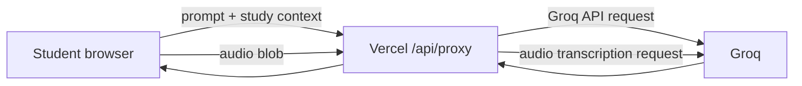
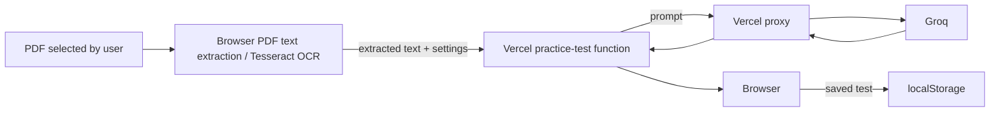
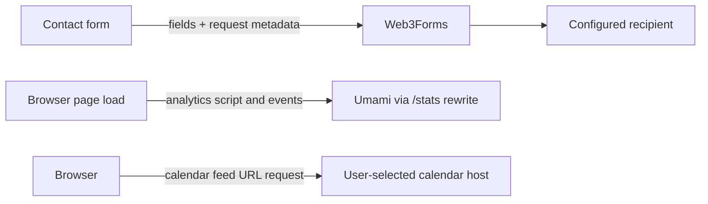

# StudyQ technical privacy and security audit

**Audit basis:** repository source and deployment configuration available in this checkout, reviewed 15 November 2026. This is a code review, not a live network, production configuration, penetration, or legal audit. No secrets are reproduced here.

## Scope and limits

Reviewed all tracked website HTML, JavaScript, CSS, API functions, and `vercel.json` discoverable in this repository. Searches covered browser storage, cookies, external requests, AI, uploads, file processing, rendering sinks, and deployment routes. There is no `package.json`, lockfile, Cloudflare Worker, separate cookie/terms/AI policy, or visible test/lint configuration in the checked-in project. This means dependency vulnerability status, provider account settings, DNS, hosting logs, environment configuration, and production network behavior cannot be verified here.

## Executive summary

The site is a static frontend with Vercel serverless/edge endpoints. There are no account/authentication flows or database configuration visible in this repository. Study data is persisted in first-party `localStorage`; the home page also uses `sessionStorage` for short-lived navigation return state. Code sends selected prompts/material to Groq through `/api/proxy`, and open-answer grading to OpenRouter through the same proxy. Contact form submissions go directly to Web3Forms. Umami tracking is exposed through a Vercel rewrite at `/stats/`. Calendar feeds are fetched from the browser. PDF text/OCR is processed in-browser before user-initiated test generation can transmit extracted text.

No cookie creation/access, IndexedDB, Cache Storage, or service worker registration was found in source searches. This does not establish what hosting/provider infrastructure may set. Retention at external providers, processing regions, controller/processor roles, contractual safeguards, and actual legal basis are not documented in source and remain unverified.

## Data inventory

| Data | Purpose | Storage/flow evidenced in code | Deletion/retention | Notes |
|---|---|---|---|---|
| Language (`StudyQ-language`) | UI language | `localStorage` | Persists until browser data cleared; no expiry in code | Preference; no external transmission identified beyond ordinary requests. |
| Sidebar collapsed (`StudyQ-sidebar-collapsed`) | Navigation preference | `localStorage` | Persists until cleared | Preference. |
| Flashcards (`StudyQ-flashcards`) | Decks/cards/progress | `localStorage` via `flashcards/flashcards.js` | Persists; clearing browser site data removes it | User content; inspect exact state schema before claiming no identifying data. |
| Vocabulary (`StudyQ-vocab-session`) | Practice session | `localStorage` | Removed on completion in some flow; otherwise persists | User-entered words/definitions may be personal if identifiable. |
| Planner tests/homework/history | Planning features | `StudyQ-planner-tests`, `StudyQ-planner-homework`, `StudyQ-planner-history`; `localStorage` | Persists until feature removes or browser data cleared | Dates, subjects, task descriptions may identify or reveal student routines. |
| AI planner state | Resume/display planner output | `StudyQ-planner-ai-output`, `StudyQ-planner-ai-timetable`, `StudyQ-planner-ai-focus`, `StudyQ-planner-active-ai-block`, `StudyQ-planner-completed-progress` | Persist until explicit removal/browser clear; no uniform expiry found | Planner conversation history also uses `StudyQ-planner-conversation-history`, capped to 12 turns/6,000 chars and pruned at 12 hours in `planner/planner.js`. Verify duplicate/legacy keys in planner page. |
| Sound/ambient settings | Audio preferences | `StudyQ-ambient`, `StudyQ-planner-ambient`, `StudyQ-planner-sound` | Persistent | Preference values. |
| Practice test history | Save/use tests | `StudyQ-practice-test-history-v1` (code key) | Browser persistence; feature deletion available | Generated tests/material may contain personal information. |
| Tool bridge/state | Transfer state between homepage/tools | `StudyQ-tools` and `sessionStorage` keys for navigation return state | `sessionStorage` ends with tab session; localStorage keys persist | Exact payload may include user tool inputs; verify usage before relying on broad policy wording. |
| Contact message/name/email/topic | Respond to enquiries | Browser POST directly to `https://api.web3forms.com/submit` | Provider/recipient retention unknown in repo | Contact email optional in UI; message/topic required. Provider receives request metadata including network address. |
| AI planner prompts/context | Generate plans | Browser → Vercel `/api/proxy?path=groq/...` → `api.groq.com/openai/v1/...` | No StudyQ DB evident; provider/proxy logs and retention unknown | Payload can include user prompts, saved study context, tests/homework, history. Server key is environment-backed, not embedded in client. |
| Voice audio | Transcription | Browser MediaRecorder → Vercel proxy → Groq audio transcriptions | No local persistence evident; provider retention unknown | Permission activated by user; code caps recording at 120 seconds. Audio bytes are transmitted. |
| Practice-test text/PDF | Create test | PDF is parsed/OCR'd in browser; extracted text → `/functions/api/practice-test` → configured proxy URL (default Vercel `/api/proxy?path=groq/chat/completions`) → Groq | Browser stores test history; external retention unknown | Frontend caps PDF at 50 MB/100 pages and material at 100,000 chars; OCR uses Tesseract.js/CDN dependencies. Server validates material length/settings and request length. PDFs/images themselves are not submitted in this route; extracted text is. |
| Open-answer grading | Evaluate answers | Browser/function → Vercel proxy `?path=openrouter/chat/completions` → `openrouter.ai/api/v1/chat/completions` | Provider retention unknown | Proxy forces `liquid/lfm-3-1.7b:free`; request body limited to 50,000 serialized chars, max tokens capped at 2,400. Verify actual frontend path/model prompt. |
| Calendar feed | Import schedule | Browser `fetch` to user-provided URL, with `credentials: omit`, CORS mode | Browser feature state may persist; provider logs unknown | URL may be a bearer-like secret. Third-party calendar host receives request/IP. This design is vulnerable to abuse if arbitrary URLs are accepted; inspect allowlist/proxy behavior before exposing as a general feature. |
| Analytics | Site usage | Site loads `/stats/script.js`; Vercel rewrite sends it to `cloud.umami.is` | Umami account settings/retention unknown | Tracking configured with DNT and query/hash exclusions in page snippets; actual script/runtime behavior and DNT support require live verification. Automatic load; no consent UI found. |
| Fonts | Render typography | Google Fonts CSS/font requests | Google receives request/network metadata; retention/location unknown | External requests on pages with Google Fonts. |
| Static hosting/CDN | Serve pages/assets/functions | Vercel implied by API and rewrite config | Access/security logs and retention unknown | Hosting, region, backups, and log policies require account configuration. |

### Storage APIs

- `localStorage`: confirmed; key inventory above. No expiry mechanism is built into the API; persisted until removed/cleared.
- `sessionStorage`: confirmed on homepage for scroll/tool return state; session-scoped.
- Cookies: no `document.cookie` or cookie library usage found in source. External services/hosting may still set cookies; verify in browser network/storage panel.
- IndexedDB, Cache Storage, service workers: no usage/registration found.
- Browser file APIs (`FileReader`, PDF libraries, `MediaRecorder`, Blob/object URL) are used for local file/audio workflows; not persistent storage on their own.

## AI and external service inventory

| Provider | Implemented function | Data sent | Region/retention/role |
|---|---|---|---|
| Groq | AI planner, practice-test generation, Whisper transcription | Prompts, study context, extracted text; audio for transcription | Not verifiable from source; obtain current DPA, retention/no-training settings, subprocessors, region and transfer terms. |
| OpenRouter | Answer grading model route; forced model `liquid/lfm-3-1.7b:free` | Grading prompt and answer/material context | Not verifiable from source; obtain account/model routing, retention/training and transfer terms. |
| Vercel | Static hosting, `/api/proxy` edge function, `/functions/api/practice-test`, `/stats/` rewrite | Request bodies, IP/headers/technical metadata inherent to requests | Project region, log retention, DPA and function logs unknown. |
| Web3Forms | Contact form submission | Form fields, request metadata | Provider/recipient retention and location unknown. |
| Umami Cloud | Analytics script via rewrite | Page analytics and technical metadata per tracker configuration | Account plan/region/retention unknown. |
| Google Fonts | Fonts | Browser request metadata | Verify font hosting/privacy implications; no self-hosted fonts. |
| Tesseract.js CDN | OCR code/worker/language assets | Asset requests; OCR text processing appears local | Exact CDN host/version behavior should be confirmed from page script references. |
| Calendar host chosen by user | iCalendar fetch | Calendar URL and request metadata | Host varies; feed content is returned to browser. |

Not found as implemented providers: Cloudflare Workers/AI, Moondream, standalone Whisper provider, or any authentication/database service. Whisper model usage is via Groq, not a separate direct endpoint. OpenRouter and Groq are both live code routes.

## Data-flow diagrams

## Security review findings (source-level)

### High priority

1. **Groq proxy path is broadly open.** `api/proxy.js` accepts any path beginning `groq/` and appends it to the Groq API base. It forwards arbitrary POST bodies using the server API key, with no authentication, rate limit, explicit endpoint allowlist, request-size cap, or timeout. Wildcard CORS is default when `ALLOWED_ORIGIN` is unset. This can enable quota abuse and unintended access to provider API operations. Restrict exact endpoints/methods, enforce body schemas/size/timeouts, set explicit origins, and rate-limit at edge/WAF.
2. **OpenRouter grading route lacks user-level abuse controls.** It validates message array and body size but not message schema/content or request frequency; wildcard CORS by default. Add route-specific schema limits, rate limits, and strict origin policy (CORS is not authentication).
3. **Calendar URL fetch requires SSRF/secret-link design review.** Browser-side fetching avoids server SSRF, but arbitrary user links can leak through browser/provider requests and third-party sites; validate accepted protocols/hosts and clearly warn about secret feed links.

### Medium priority

4. **Contact form access key/configuration is client-side.** Inspect `contact/index.html` hidden Web3Forms access key and treat as public; add abuse prevention/rate limits and spam controls. Avoid exposing personal recipient configuration.
5. **Potential HTML injection sinks.** Numerous `innerHTML` sites render user, AI, imported calendar, or stored content. Some use `escapeHtml`/trusted fixed strings, but a complete sink-by-sink taint audit is needed, especially `planner/planner.js` AI formatting, `planner/index.html` recommendation/calendar rendering, `pomodoro` PiP, and vocab translation/feedback. Prefer `textContent`/DOM construction or strict escaping/sanitization.
6. **No security headers configured in `vercel.json`.** No CSP, HSTS, `X-Content-Type-Options`, `Referrer-Policy`, or `Permissions-Policy` configuration found. Add carefully tested headers; CSP needs allowance for existing inline scripts/styles and providers.
7. **Dependency inventory absent.** No package manifest/lockfile means automated dependency audit cannot enumerate browser libraries. Third-party CDN versions and integrity pinning need inventory; add SRI where feasible.

### Lower priority / operational

8. No auth or user database evident, so classic CSRF/SQL injection are not applicable to current routes; endpoints are public, making rate limiting/input validation more relevant.
9. `functions/api/practice-test.js` validates generation inputs, response shape, content length, and has a 27-second timeout, but default proxy URL is production-host hardcoded and endpoint deployment mapping should be confirmed. OPTIONS response has no `Access-Control-Allow-Origin` header; verify cross-origin behavior.
10. Error responses mostly use generic codes. Confirm platform logs do not capture request bodies; no explicit application logging of prompts found in reviewed endpoint code.
11. HTTPS is used for hard-coded external endpoints and production canonical URL; HTTP-to-HTTPS enforcement is platform configuration and not verifiable here.

No destructive testing or external probing was performed. This is not a penetration test or proof of exploitability.

## GDPR / ePrivacy assessment (technical observations, not legal opinion)

- Likely personal data can arise in student schedules, homework, prompts, voice and messages even without accounts or names.
- The controller identity is represented as a personal name in current page source; legal identity/contact and establishment details require owner verification. Do not invent company identifiers.
- Legal bases are not encoded in software. Feature-by-feature basis, balancing tests for legitimate interests, consent where required, and provider controller/processor roles need legal review.
- Analytics loads automatically. Whether Umami configuration qualifies for an exemption under Dutch rules is a legal and technical determination; current code does not gate it on consent.
- Because users may be minors, use plain-language notices and minimize prompts/material; assess parental-consent rules only for processing based on consent and relevant service circumstances.
- International transfers, SCCs/adequacy, provider regions, retention, model training, deletion, subprocessors and DPA status are not determinable from source. Obtain current contracts/provider settings and document them.
- User rights can be requested at the published email. Local-only information must generally be deleted by the user in browser storage; server/provider requests require contact with controller/providers. No self-service export/delete account exists.

## Legal pages and consent

Only the privacy page is present; no standalone Cookie Policy, AI Transparency page or Terms page was found. The homepage and footer link to privacy. No cookie consent manager is implemented. Since source found no first-party cookie usage, do not call localStorage cookies. But analytics and external assets are third-party requests and must be assessed under applicable ePrivacy rules before concluding a banner is or is not required. This audit did not introduce a banner or change tracking behavior.

The existing privacy page should be treated as provisional. Its detailed statements need comparison against production deployment/provider settings. A complete, legally reliable notice cannot be generated from source alone because operator legal identity, legal bases, provider DPAs, geographic regions, retention, and analytics configuration are not in the repository.

## Required follow-up evidence

1. Vercel project settings: function regions, environment variable names (never values), logs/retention, security headers, WAF/rate limits, access controls, DPA.
2. Groq/OpenRouter/Web3Forms/Umami account data terms, subprocessors, region, retention, training use, deletion, and DPA/SCC documents.
3. Production browser network + storage inspection: cookies, analytics payloads, headers, localStorage keys/values, and actual calendar destinations.
4. Owner confirmation of controller legal identity/contact and documented purpose/legal-basis/retention decisions.
5. Full manual XSS review of dynamic HTML sinks; automated dependency audit once manifests/CDN versions are inventoried.

## Files changed by this audit

- `docs/studyq-privacy-security-audit.md` (this report).

No application behavior, provider integrations, consent behavior, or user data handling was changed by this report.

## Remediation update — 15 November 2026

Source changes made after the original audit:

- `api/proxy.js` now uses exact route allowlists for Groq chat, Groq transcription, and OpenRouter chat; rejects other methods/query parameters/routes; validates request fields/models/content types; bounds JSON/audio inputs and upstream response bodies; applies an upstream timeout; blocks redirects; and returns generic errors. CORS uses exact origins from `ALLOWED_ORIGIN`, defaulting to the StudyQ production origin. API keys remain environment references.
- Contact form remains a direct browser-to-Web3Forms submission. Its access key is a public client-side identifier by provider design, not a secret.
- `vercel.json` adds security headers and a CSP Report-Only policy.
- Added cookie/storage, AI transparency, and terms draft pages and supporting data/provider/security/compliance documents.

### Status by finding

| Original finding | Status |
|---|---|
| Broad Groq route | PARTIALLY FIXED: route/schema restriction implemented; deployed integration and abuse tests remain. |
| Wildcard CORS | PARTIALLY FIXED: source defaults to exact production origin; deployment must set exact origins. |
| No durable rate limits | REQUIRES MANUAL CONFIGURATION: Vercel Firewall/WAF per-IP and route-specific policies. No fake in-memory limiter was added. |
| OpenRouter validation | PARTIALLY FIXED: exact route/model/schema/size controls added; deployed grading test remains. |
| Web3Forms access key | NOT A SECRET: direct client use restored per provider key design; abuse protection remains provider/WAF configuration. |
| Contact spam limits | REQUIRES MANUAL CONFIGURATION: WAF limits still required. |
| Security headers | PARTIALLY FIXED: configured, CSP is report-only and must be monitored/tested before enforcement. |
| Calendar validation/size/timeout | UNRESOLVED. |
| Dynamic HTML/XSS audit | UNRESOLVED; not every sink has been manually traced/tested. |
| Analytics consent | REQUIRES LEGAL REVIEW; no consent behavior changed. |
| Provider retention/region/transfers/legal bases | REQUIRES MANUAL CONFIGURATION and LEGAL REVIEW. |
| Dependency/SRI inventory | PARTIALLY FIXED through CDN inventory docs; automated/transitive audit remains unavailable without package manifest and full version inventory. |

### Tests actually run

Local mock tests passed for proxy unknown route, unsupported method, rejected origin, unexpected query parameter, invalid chat schema, and a valid mocked chat forward. Contact mock tests passed for method, foreign origin, and invalid topic rejection. `vercel.json` parsed as JSON; checked JavaScript files passed syntax checks. These tests do not verify live provider credentials, deployed Vercel configuration, provider response compatibility, rate limits, analytics behavior, or browser storage/network behavior.

No live services or production endpoints were tested. Full regression/security testing remains outstanding.

## Current-state re-audit — 15 November 2026

This section supersedes conflicting older status statements above. Rechecked repository files after the remediation edits and reviewed the user's Vercel Firewall screenshot. The screenshot displays an unsaved **New Rule** form for the `studystack` project: Request Path equals `/api/proxy`; fixed window 60 seconds; 10 requests; key IP Address; action Too Many Requests (429). Because it is still the New Rule screen, the rule is **not verified as added or published** and cannot yet be counted as active. After the user publishes it, one shared ceiling will apply across Groq chat, audio, and OpenRouter grading because they all use `/api/proxy`.

### Current code findings and status

| Area | Current evidence | Status |
|---|---|---|
| Groq/OpenRouter proxy routes | `api/proxy.js` allows only exact paths for Groq chat, Groq transcription and OpenRouter chat; validates methods, query parameters, fields and models; JSON cap 120,000 bytes; audio cap 4 MiB; 8,192 output-token cap for Groq chat; 55-second upstream timeout; blocks redirects; caps upstream response at 2 MB; returns generic provider errors. | PARTIALLY FIXED; local mock tests pass; deployed provider compatibility not tested. |
| CORS | Exact `ALLOWED_ORIGIN` list, default production origin. | PARTIALLY FIXED; deployment environment and staging origins unverified. |
| Abuse/rate limit | No durable limiter in source. Screenshot shows intended `/api/proxy`, 10/IP/60s, 429 rule but unsaved. | REQUIRES MANUAL ACTION; add rule, review, publish, then verify traffic/429. This one rule cannot give audio a separate limit. |
| Contact form | Direct browser POST to Web3Forms. Access key is a provider-issued public client key, not a secret. No `/api/contact` exists. | AS DESIGNED per user clarification; provider spam settings remain unverified. |
| Headers | `vercel.json` configures nosniff, referrer policy, permissions policy, X-Frame-Options, HSTS max-age one year, and CSP Report-Only. | PARTIALLY FIXED; headers have not been confirmed on a deployed response; CSP is not enforced. |
| Analytics | Automatic Umami script via `/stats` rewrite. | UNRESOLVED legal/consent assessment; no consent gate. |
| Calendar | Browser fetch of user URL with credentials omitted. | UNRESOLVED; no complete HTTPS/redirect/timeout/response-size checks verified. |
| XSS | Many dynamic `innerHTML` sinks remain across planner, vocabulary, flashcards, calculator and PiP. | UNRESOLVED; complete taint review and hostile-input tests outstanding. |
| Data storage | localStorage and sessionStorage documented; no account/database found. | PARTIALLY INVENTORIED; clear-all/export control and exact key cleanup audit remain. |
| Providers/legal | Account settings, processing regions, retention, model training, DPAs, transfer safeguards and lawful bases unavailable from source. | REQUIRES MANUAL CONFIGURATION / LEGAL REVIEW. |

### Latest local test evidence

Mock tests previously run against the current proxy code passed for unknown route, unsupported method, rejected origin, extra query parameter, invalid chat schema, and a mocked valid chat request. JavaScript syntax checks passed for 13 `.js` files; CSS brace counts passed for 9 files; simple HTML tag-stack checks passed for 15 files; `vercel.json` parsed successfully. These are source/static checks only and do not prove deployed headers, Firewall behavior, provider integration, browser privacy behavior, or feature regression.

The Web3Forms server-proxy test and implementation were removed after the user clarified that the provider key is public. Contact remains direct-to-provider.

## Final hardening pass — 15 November 2026

### Implemented in code

- Calendar URL normalization now requires HTTPS for fetching (webcal is converted to HTTPS), rejects credentials, nonstandard ports, localhost/local/internal names, IPv6 literal hosts and common private/reserved IPv4 ranges. Browser fetching omits credentials, rejects redirects, has a 12-second abort timeout, accepts only calendar/text-like response types, and streams with a 2 MiB maximum. Local `.ics` import is limited to 5 MiB. Hostname DNS resolving to a private address cannot be reliably detected in browser-only code; no URL-fetch backend was introduced.
- Privacy Policy now offers confirmation-based deletion of study keys or all `StudyQ-` local/session storage. Limited clear preserves preferences; full clear leaves unrelated origin keys untouched. Notice explains this does not recall third-party data or synchronize across devices.
- Rechecked relevant dynamic HTML sinks: planner AI formatting escapes text before limited Markdown tags; planner table/task/calendar values are escaped or assigned as text; vocabulary feedback escapes user-derived values; flashcard fields are escaped; practice-test print export escapes test data; Pomodoro PiP uses fixed markup and application-controlled labels/timer values. This review is not a complete browser-taint proof; many fixed-template `innerHTML` sinks remain and require comprehensive regression coverage.

### Rate limit evidence

The user reports that the Vercel Firewall rule has now been saved. The screenshot previously showed `/api/proxy`, fixed window 60 seconds, 10 requests per IP, and 429 action. Dashboard access and deployed traffic are unavailable in this session, so status is **IMPLEMENTED, DEPLOYMENT VERIFICATION PENDING** rather than independently verified. All Groq chat, Groq audio, and OpenRouter grading requests share `/api/proxy` and therefore the same rule/limit.

### Tests in this pass

- Calendar validator extracted from current source: passed public HTTPS and webcal inputs; rejected javascript scheme, localhost, private/loopback IPv4, credentials, and custom port.
- Privacy controls mock tests: passed canceled deletion, limited deletion preserving preferences, and full deletion preserving unrelated storage keys.
- Proxy mock tests: passed unknown route, unsupported method, foreign origin, and invalid schema checks.
- All 13 external `.js` files and 9 inline HTML scripts passed `node --check`; 9 CSS files had balanced braces; 15 HTML documents passed simple tag-stack checks; Vercel JSON parsed.
- These are local/static/mock checks only. No live Vercel 429, provider AI call, browser rendering, CSP report, consent behavior, or full feature regression was verified.

### Remaining status

- Firewall saved according to user, but published deployment and 429 response: **IMPLEMENTED, DEPLOYMENT VERIFICATION PENDING**.
- CSP: **IMPLEMENTED, DEPLOYMENT VERIFICATION PENDING**; remains report-only. Inline script/style use makes immediate enforcement risky.
- Calendar: **PARTIALLY FIXED**; browser cannot reliably resolve DNS to determine whether a hostname targets private infrastructure. Redirect rejection and stricter content-type handling need testing against real calendar providers.
- XSS: **PARTIALLY REVIEWED**; relevant dynamic values appear escaped or assigned as text in inspected sinks. Exhaustive taint testing across all routes and browsers remains outstanding.
- Analytics consent, legal bases, controller details, provider regions/retention/training/DPAs/transfers: **REQUIRES LEGAL REVIEW / MANUAL VERIFICATION**.
- Complete end-to-end regression of all StudyQ features: **UNRESOLVED** pending browser access and provider configuration.

## Practice Test rate limit — 15 November 2026

Added a dedicated Vercel `/api/practice-test` route and changed the Practice Test browser flow to use it for test generation. The endpoint uses atomic Upstash Redis REST Lua scripts to reserve one of five per-IP slots, and commits that slot only after all output batches form a valid complete test. Invalid requests are rejected before reservation; handled Groq errors and malformed outputs release reservations. The route returns HTTP 429 with an hourly limit explanation and retry time when full. The Practice Test UI reads the allowance from the server and updates it after success; local/session storage is not part of enforcement. Other AI features continue using `/api/proxy` and are not included in this quota.

The Redis keys contain a keyed HMAC digest of the Vercel-provided client IP, timestamps and random request identifiers only. They do not contain prompts, PDFs, extracted material, settings or outputs. Completed records expire after 60 minutes and abandoned pending reservations after two minutes. This digest remains pseudonymous personal data and requires appropriate provider/privacy review.

Local mocked handler checks passed for fail-closed behavior when Redis is missing, generations 1–5, 429 on generation 6 without an extra Groq request, duplicate IDs, release after a mocked provider failure, fake-clock rolling expiry, and eight simultaneous requests producing five accepted and three rejected results. The mock modeled Redis in memory and did not execute the Lua scripts, so it does not verify Redis atomicity. A mocked GET also passed through the Vercel Node request adapter. JavaScript source parsing passed. No browser, live Redis, live Groq or production test was possible because no store is configured and no Redis server is installed in this environment.

| Verification | Status |
|---|---|
| Frontend and endpoint JavaScript parse | **FIXED AND TESTED** locally with the JavaScript runtime parser. |
| 1–5 accepted, 6th returns 429 | **IMPLEMENTED, DEPLOYMENT VERIFICATION PENDING**. No Redis service is connected in this checkout. |
| Failed generation does not consume a completed allowance | Implemented using reservation release; **live Redis/Groq test pending**. |
| Rolling expiry and simultaneous submissions | Atomic Lua scripts are in source; **not yet executed against Redis**, so production atomicity has not been verified. |
| Other AI tools unaffected | Source path review confirms separation; deployed smoke test pending. |
| UI count, refresh, clearing storage bypass | Server-backed UI implemented; browser/deployed tests pending. |
| Durable storage environment | **REQUIRES MANUAL CONFIGURATION**: connect Upstash Redis in Vercel and set `STUDYQ_RATE_LIMIT_HMAC_SECRET`; keep `GROQ_API_KEY` configured. Missing storage fails closed with 503. |

See [Practice Test generation rate limit](practice-test-rate-limit.md) for setup, privacy details, and the full test matrix. This feature is **not complete for production** until the store is connected and the generation, failure, reset, concurrency, and UI checks are run against the deployed route.

## Analytics consent remediation — 15 November 2026

The consent manager was later removed at the owner's request; see the latest analytics update below.

### Current overall statuses

- Proxy endpoint/schema protections: **FIXED AND LOCALLY TESTED**, deployment provider compatibility pending.
- Vercel rate limit: user reports saved; **IMPLEMENTED, DEPLOYMENT VERIFICATION PENDING** because dashboard/429 cannot be inspected from this workspace.
- Contact form: direct Web3Forms with public client key, per user instruction; no server proxy.
- Calendar protections: **PARTIALLY FIXED AND LOCALLY TESTED**; DNS-to-private resolution cannot be guaranteed client-side and provider regressions pending.
- Storage clear controls: **FIXED AND LOCALLY TESTED**; browser end-to-end remains pending.
- Analytics consent gate: **REMOVED at the owner's request**; automatic loading is restored on configured pages. Production network verification and legal review remain pending.
- XSS: reviewed sinks appear escaped/static in inspected paths; exhaustive repository-wide browser hostile-input coverage remains **UNRESOLVED**.
- CSP remains report-only; production violation review and enforcement remain pending.
- Provider terms/settings, transfer mechanisms, lawful bases, controller identity particulars and minor-specific obligations remain **REQUIRES MANUAL CONFIGURATION / LEGAL REVIEW**.

## Analytics loading restored — 15 November 2026

Removed the accept/reject consent banner, controls, script and stylesheet. The ten HTML pages that contained the inert Umami metadata now load the existing `/stats/script.js` directly with the same website ID and host URL, plus the existing query-string, fragment and Do Not Track settings. The Cookies and browser storage page now describes automatic analytics and no longer offers controls. The `StudyQ-analytics-consent` localStorage entry is no longer read or written. Production requests have not been inspected, so this is source-level verification only.
